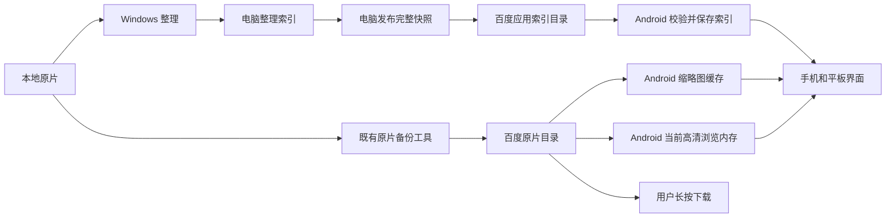

# 生活点滴双端开发与维护

当前基线为 Windows 0.3.0-beta.9 和 Android 0.1.0-beta.5。仓库保留可构建的双端源码、固定版本依赖恢复脚本、合成演示素材和使用文档。个人原片、真实索引、凭据和设备资料独立保管，不通过 Git 上传。

## 系统结构与数据流

Windows 使用 WinForms 与 WebView2：原生层读取本地照片、保存整理索引、解码图片并发布百度索引；网页负责时间线、人物、相册、地图和交互。

Android 使用原生 Activity 与本地 WebView：原生层处理授权、网盘读取、索引校验、图片缓存、内存高清、下载和局域网迁移；网页读取经过校验的本机快照，负责手机与平板界面。



电脑发布、Android 消费索引。当前没有多台电脑写入合并、手机编辑整理资料或冲突解决协议。原片上传不属于 `BaiduSync` 的职责。

## 目录与主要文件

| 位置 | 职责 |
| --- | --- |
| `desktop/DesktopApp.cs` | Windows 宿主、目录会话、网页桥接、资源服务、同步调度 |
| `desktop/PhotoLibrary.cs` | 照片发现、稳定路径编号、元信息缓存、共用整理索引 |
| `desktop/JpegMetadata.cs`、`HeifDecoder.cs` | JPEG EXIF、HEIF 元信息与预览解码 |
| `desktop/BaiduSync.cs` | 原生百度授权、Windows 加密凭据、完整索引上传 |
| `desktop/LoadingScreen.cs`、`Installer.cs` | 原生开屏和 Windows 安装卸载 |
| `desktop/build_frontend.py`、`frontend.js/css`、`tag_editor.js/css` | 生成桌面界面及桌面扩展 |
| `preview/` | 共用模板、地图资源、合成演示素材 |
| `android/app/src/main/java/com/lifemoments/reader/` | Android 原生功能，含全图库缓存与局域网迁移 |
| `android/app/src/main/assets/mobile.js/css`、`core.js` | 移动界面、响应式布局、索引展示和图片调度 |
| `android/build-assets.py` | 品牌、地图资源、合成演示和内置教程生成 |
| `scripts/restore-dependencies.ps1` | 恢复构建所需的固定版本第三方资源 |
| `config.example.json`、`requirements.txt`、`tools/package.json` | 配置样例、Python 和界面回归依赖 |

Android 原生目录中，`MainActivity.java` 管窗口安全区、生命周期、桥接、高清会话和下载；`CloudReader.java` 管百度接口与缓存；`ThumbnailWarmup.java` 管预热、优先级让路、暂停续跑与失败重试；`LibraryStore.java` 管索引；`CredentialVault.java` 管安全存储；`PhoneDownloads.java` 管系统相册保存。`LocalDeviceTransfer.java`、`TransferWire.java`、`TransferCrypto.java`、`TransferPayload.java` 管迁移。`NativeUi.java` 与样式资源统一原生连接、下载和迁移窗口，保持网页配色、字体与间距，并适配键盘及可用窗口宽度。

生成后的 `desktop/app/index.html`、Android 品牌与演示资源由脚本管理。修改生成逻辑或源模板后重新生成，不应只改构建输出。

## 构建环境与依赖

在 Windows 上准备 Git、Python 和 PowerShell。桌面构建需要 .NET Framework 4.8、系统 C# 编译器与 WebView2 Runtime；Android 构建需要 JDK 17+、Android SDK 35 和 Build Tools 35。Node.js 与 Playwright 只用于界面回归。

从仓库根目录建立 Python 环境：

```powershell
git clone https://github.com/ccl4-56-23-5/life-moments.git
Set-Location life-moments
python -m venv .venv
$pythonPath = (Resolve-Path .\.venv\Scripts\python.exe).Path
& $pythonPath -m pip install -r requirements.txt
& .\scripts\restore-dependencies.ps1
```

私有仓库克隆需要先通过 GitHub 认证。第三方依赖下载到被忽略的本机目录，源码中保留固定版本、恢复逻辑和许可文件。首次构建可联网恢复；完全离线构建需提前准备依赖、Gradle 发行版、Android Gradle Plugin 与 SDK。

复制本地地图配置：

```powershell
Copy-Item .\config.example.json .\config.local.json
```

在 `config.local.json` 的 `mapStyleUrl` 填写自己的 MapTiler 样式 URL。该文件被 Git 忽略，构建时读取并生成各端地图配置；空 URL 使用空白底图与已有位置点。配置中不要添加百度密钥或令牌，它们由运行时原生连接窗口保存。

### Windows 构建

```powershell
& .\desktop\build.ps1 -PythonPath $pythonPath
```

构建先生成前端，再编译 x64 宿主和安装程序。程序位于 `desktop/out`，安装程序位于 `desktop/artifacts`。依赖包括 WebView2 SDK 1.0.4258.31、Magick.NET 14.17.2、MapLibre 和 Lucide；运行仍需要系统安装的 WebView2 Runtime。依赖已经恢复时可为此命令加 `-Offline`。

不要把原片目录当作安装目录或构建输出。调试可运行 `desktop/out/生活点滴.exe`，正式给用户交付安装程序并附版本与校验值。

### Android 构建

先把 `ANDROID_HOME` 配为本机 SDK 目录，把 `JAVA_HOME` 配为本机 JDK 目录，再执行：

```powershell
& .\android\build.ps1 -SdkPath $env:ANDROID_HOME -JdkPath $env:JAVA_HOME -PythonPath $pythonPath
```

构建生成资源，使用 Gradle 8.13、Android Gradle Plugin 8.13.2，执行 `assembleDebug` 和 `lintDebug`。产物为 `android/artifacts/生活点滴-安卓-0.1.0-beta.5.apk`。依赖已缓存时可加 `-Offline`；缺少 SDK、Gradle 或依赖时应按提示先恢复，不以跳过 Lint 代替修复。

当前 APK 使用 debug 签名供个人侧载测试。覆盖升级要求包名 `com.lifemoments.reader` 和签名一致；不同电脑默认 debug keystore 可能不同。发布签名文件独立备份，不提交到仓库。正式渠道发布需另行配置 release 构建、签名与平台审核。

构建脚本可能改变当前目录，后续步骤应显式回到仓库根目录或使用完整路径。

## 本机资料与备份

| 数据 | 位置与规则 |
| --- | --- |
| Windows 整理资料 | `%LOCALAPPDATA%\LifeMoments`；包括 `library-index-v2.json`、`settings.json`、元信息缓存和网页运行资料 |
| Windows 网盘连接 | 用户资料目录中的加密文件，以当前 Windows 用户 DPAPI 保护 |
| Android 索引 | 应用私有 `files/library-v2.json`，通过 `AtomicFile` 提交 |
| Android 网盘凭据 | 应用私有 `credentials.enc`，Android Keystore 与 AES-GCM 保护 |
| Android 缩略图 | 应用私有 `files/thumbnails-v2`；普通高清浏览不创建原片文件 |
| 明确下载的照片 | Android 10+ 的 `Pictures/生活点滴`，Android 9 的用户选择位置 |

Git 备份与原片、整理资料备份分开。恢复 Windows 索引时保留原片完整路径；照片编号由规范化完整路径产生，移动目录或换盘符不能自动保持同一身份。跨设备内容指纹与编号别名尚未实现。

不要把 Windows 加密凭据当作可在其他账号直接使用的普通配置；Android Keystore 密钥也不能复制到另一台设备。Android 迁移只传加密通道内的配置内容，由新设备重新加密。

## 百度索引与原片定位

云端索引格式为 `schemaVersion: 2`，包含 `libraryId`、`cloudRoot`、照片列表和整理索引。照片记录保存 `relativePath` 与完整 `cloudPath`；头像保存来源照片编号与比例选框。

电脑快照排除本机照片路径、网页图片资源 URL 和网盘凭据。发布文件名包含时间与版本，采用预创建、分片上传、MD5 校验、创建完整文件的顺序；无变化的快照不重复上传。OAuth 的等待与降速响应由授权轮询处理，上传 JSON 兼容 UTF-8 BOM 与 `charset=utf8`。

Android 从索引目录列出候选快照，校验成功后才提交，失败保留旧数据。原片根目录不一致时，`LibraryStore.bindRoot` 校验相对路径与旧根目录，再映射到手机配置的根目录。不能以同名文件猜测替代完整路径匹配。

`CloudReader` 通过父目录分页列表获得 `fs_id`，再使用 `multimedia/filemetas` 获取缩略图与下载地址。目录元信息缓存约 15 分钟，文件元信息约 6 小时；预热可批量准备最多 64 个文件的元信息。令牌刷新串行处理，新的授权会话不能被旧请求覆盖。下载地址限定在既有百度域名白名单。

复用 AppKey 与 SecretKey 可让双端使用一个百度应用，不能突破平台目录、人数或接口配额。源码、安装包样例、日志和网页桥接不得包含真实百度凭据。

## 图片调度与内存

Android 缩略图磁盘上限为 1 GiB，保留至少 128 MiB 空闲空间。预热最多两个后台 worker，跳过已有缓存；到容量上限停止全图库任务，避免反复淘汰重下。正常浏览可按近期访问清理旧缓存。缓存身份包含会话、完整路径、大小和时间，不能只按文件名命中。

网页缩略图复用最多 96 个 Blob URL，图片队列最多两个请求，优先屏幕内照片，并预取附近区域。取消、超时、错误和完成都释放队列名额；不能依赖已从 DOM 移除的图片一定触发 load/error。

高清请求为当前照片独立会话，先取消旧请求并让后台预热让路。原始字节仅保存在内存中；64 MiB 硬限之外，还需按堆余量估计预算。显示最长边最高 4096 px，低内存尝试更小尺寸并给出可恢复错误。关闭、换片、锁屏或系统低内存时释放原始与显示字节。

普通浏览资源使用 `Cache-Control: no-store`。失败返回真实 404/503 与可读状态，不能返回 HTTP 200 的灰色失败 SVG。明确下载保留原片字节与格式；Android 10+ 先创建 `IS_PENDING=1` 文件，完整写入后发布，失败删除本次未完成文件。

## 生命周期与界面规则

原生窗口根据系统栏、挖孔及输入法区域调整 WebView 实际边界，开屏使用相同安全区。不要只加网页 padding 来修复系统区域重叠。

锁屏或切后台暂停预热、取消图片连接和高清 Future，并通知网页取消 fetch。回到应用清理暂态失败，重试当前附近图片并续跑预热。渲染进程退出后，销毁不可复用的 WebView，提供原生恢复入口；不能让应用退出或无限自动重载。

手机小图只显示照片。展开后的资料界面显示人物小头像，多人合照分批展开并支持搜索；人物页使用既有头像。平板布局按当前宽度决定，不以设备型号硬编码。头像、人物标签、批注和相册来自同一整理索引。

开屏与双端页面使用共同品牌资源和缓动。页面过渡只处理少量当前可见元素，不能变换整个长时间线或 sticky 祖先；遵循系统减少动画设置。

## 局域网迁移协议

迁移入口显式打开后才扫描或发布服务，三分钟后关闭。NSD 使用 `_lifemoments._tcp.`，只公布随机名称、协议版本与端口；发现失败可手动输入数字 IP 地址，不解析任意主机名。

`TransferWire` 先交换临时 P-256 ECDH 密钥和随机数的承诺，再揭示并验证；派生方向独立的 AES-GCM 密钥和同一组六位屏幕验证码。两边都人工核对并确认后，才传输设置。帧校验序号、方向、认证标签和期限，拒绝篡改、重放与乱序。

`TransferPayload` 严格白名单覆盖网盘凭据、五项本机业务设置、三项网页浏览偏好和校验后的索引。传输压缩内容最多 16 MiB，解压限 64 MiB 索引加少量配置空间；字段、枚举、路径、根目录与会话绑定在写入前校验。

接收期间暂停读取，写入失败恢复原设置。网盘密钥与令牌只在原生层和认证通道中流转，网页仅导入导出浏览排序、分组与相册排序。照片、缩略图、Keystore 密钥及调试恢复状态不迁移。复制授权快照不能承诺生成两个独立 OAuth 会话，续期失败时重新授权。

升级 targetSdk 或 NSD API 时，重新核对 [Android NSD 文档](https://developer.android.com/reference/android/net/nsd/NsdManager) 和 [局域网访问权限](https://developer.android.com/privacy-and-security/local-network-permission)。当前为 targetSdk 35。

## 回归验证

界面回归需要 Node.js 与 Playwright。安装 `tools/package.json` 中的依赖后，从仓库根目录执行：

```powershell
npm --prefix tools install
node .\android\tests\ui-test.cjs
node .\android\tests\artifact-check.cjs
& .\android\tests\warmup-test.ps1 -JdkPath $env:JAVA_HOME
& .\android\tests\transfer-test.ps1 -JdkPath $env:JAVA_HOME
```

浏览器验证覆盖手机至平板宽度、合照大量人物、时间线、大图、长按、取消恢复、缓存状态和迁移网页偏好。高清桥接、网络和地图使用明确替身，不能证明真实百度速度或系统 API 行为。JVM 测试执行真实调度、密码、socket 协议、迁移 payload 和索引方法；测试 JSON 依赖按固定 SHA-256 校验。

连接 Android 实体设备或可稳定运行的模拟器后，可执行调试包内的 `ReaderNativeProbe`、`ReaderDeviceProbe`、`ReaderTransferProbe`。它们用于索引、缓存、Keystore、MediaStore、内存解码与隔离迁移夹具。`ReaderCloudProbe` 涉及当前已授权账号，应明确选择只读诊断或同步模式，不作为离线测试运行。

Windows 原生回归使用 `--self-test --test-data <独立临时目录> --source <照片夹具目录>`。`--test-data` 必须是独立测试资料目录，不能指定实际用户资料。测试写入测试人物与相册，运行产生的截图和索引也不应上传到仓库。

当前离线记录通过 11 项缓存调度、19 项密码协议、13 项生产 socket 协议和 54 项迁移数据与索引检查。新增 Android Keystore 导入、系统 NSD、实体设备锁屏恢复和真实读取速度仍需设备测试。新的构建或界面变化应运行对应检查，不能把旧包真机结果直接记为新版已通过。

## 发布与维护记录

发布前同步 Windows 安装记录与界面版本、Android versionCode/versionName、安装包名、README、教程和版本记录。保留 Android 包名与签名，验证安装包哈希，并把二进制作为 Release 附件；不把构建输出、签名或个人测试资料混入源码提交。

每次变更记录问题、最终行为、验证方式和剩余设备覆盖。在 GitHub issue 或反馈中使用脱敏信息：系统与 WebView 版本、应用版本、网络类型、所在页面、完整错误文字和必要步骤。不要上传真实令牌、带令牌的下载地址、个人完整索引或未经处理的照片。

遇到图片问题先区分缩略图、内存高清与明确下载；遇到索引问题先核对完整目录、授权会话、schemaVersion 和备份状态。发布修复时保留已有索引和用户明确下载的照片。
